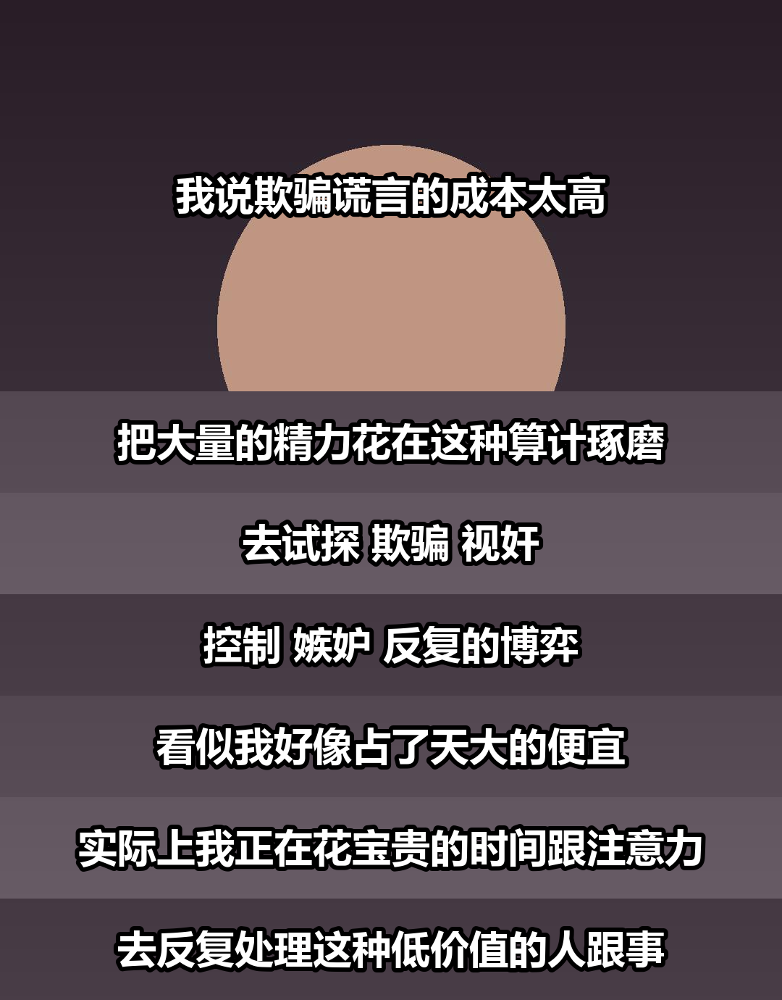

# video-quote-card · 视频截图金句卡生成器

把口播视频的截图 + 文案，合成为一张竖版「金句卡」：截图裁成横条上下堆叠，每句文案以白字 + 黑描边 + 柔和投影叠在横条上，首条更高用来展示人物。

适合公众号 / 视频号 / 小红书的口播内容二次分发——把长视频里的一句话金句做成可单独发布的图文。



## 效果说明

- 首条高图（默认占宽度 0.72）展示人脸，字幕贴底不压脸
- 后续每条 = 一句文案 + 一条画面横带，条高随文字自动收紧（不留大片空白）
- 文字 = 白色填充 + 黑色描边 + 黑色柔和投影，背景完全不动（不使用压暗罩，避免出现贯穿整行的黑带）
- 条与条之间 2px 纯黑分隔缝

## 安装

```bash
git clone https://github.com/JasonBour/video-quote-card.git
cd video-quote-card
pip install pillow
```

作为 WorkBuddy / Claude Code 的 skill 使用时，把整个目录放到用户的 skills 目录下即可（`~/.workbuddy/skills/video-quote-card/`）。

## 使用

### 1. 从视频抽帧（可选）

```bash
# 候选帧拼图：先看整体构图，挑表情/手势好的帧
ffmpeg -i video.mov -vf "fps=1/5,scale=270:-1,tile=8x2" -frames:v 1 candidates.jpg

# 精确抽第 N 秒的全尺寸帧
ffmpeg -ss 27.5 -i video.mov -frames:v 1 f1.jpg
```

### 2. 生成金句卡

```bash
python scripts/make_card.py \
  --images f1.jpg f2.jpg f3.jpg f4.jpg \
  --lines "你赚不到钱 不是因为不够努力|是因为你把时间 都花在不赚钱的事上|真正赚钱的人 只做一件事|从今天起 只做让你变值钱的事" \
  --out card.png
```

文案也可以放文件里（每行一句）：

```bash
python scripts/make_card.py --images shots/ --text copy.txt --out card.png
```

`--images` 传目录时按文件名排序，建议命名 `s1.jpg s2.jpg ...`；截图数量不足时脚本会循环复用。

### 3. 精确定位每条画面

先用一张全尺寸帧量出人脸、手势的 y 坐标，再逐条指定裁切位置（`top:N` = 距画面顶部 N 像素）：

```bash
python scripts/make_card.py \
  --images t2.jpg f2.jpg f3.jpg f4.jpg f5.jpg f6.jpg f7.jpg f8.jpg \
  --lines "句1|句2|句3|句4|句5|句6|句7|句8" \
  --crops "top:400,top:1250,top:1250,top:1250,top:1250,top:1200,top:1150,top:1250" \
  --out card.png
```

## 常用参数

| 参数 | 默认 | 说明 |
|---|---|---|
| `--width` | 1080 | 输出宽度 |
| `--first-ratio` | 0.72 | 首条高度/宽度（越大人物区越高） |
| `--font-size` | 宽/24.5 | 字号，长句自动缩小适配 |
| `--line-pad` | 0.42 | 字幕条上下留白（相对字号），越小越紧凑 |
| `--letter-spacing` | 3 | 字间距（1080 基准） |
| `--scrim` | shadow | shadow 柔和投影 / dark 压暗 / blur 模糊 / both / none |
| `--gap` | 2 | 条间分隔缝像素，0 = 无缝 |
| `--first-text` | bottom | 首条文字位置 bottom 贴底 / center 居中 |
| `--crops` | 无 | 逐条裁切位置，支持 `top:N` / `center` / `bottom` |
| `--raw` | 关 | 不加文字，纯截图条拼接 |
| `--font` | 自动探测 | 指定中文字体 ttf/ttc |

## 调参速查

| 感觉 | 怎么调 |
|---|---|
| 文字太大，占了整图大部分 | 降 `--font-size`，升 `--first-ratio` |
| 字幕条与文字之间空隙太大 | 降 `--line-pad`（0.2 很紧凑，0.4 偏松） |
| 字太挤 | 升 `--letter-spacing` 到 4~6 |
| 背景干扰阅读 | 用默认 `--scrim shadow`；仍不够再试 `blur`（尽量别用 `dark`，会出黑带） |
| 首条人脸被压住 | 调 `--crops` 首条值，或用 `--first-text center` |

## 依赖

- Python 3 + Pillow
- 中文字体：自动探测微软雅黑粗体 / 苹方 / 思源黑体等，也可 `--font` 指定
- ffmpeg：仅从视频抽帧时需要
